# 盯盘雷达 · 手机版（单文件 PWA）

**给家人朋友小范围用的行情 + 纪律提醒工具**。纯前端、无后端、无需注册，数据只存手机本地。

> ⚠️ 这不是投资顾问产品：**不内置任何买卖建议**。减仓档、止损线、亏损预算都要**使用者自己填**。
> 页面首屏有免责声明：仅供个人行情记录与纪律提醒，不构成投资建议，盈亏自负。

**线上地址（已部署并验证）**：https://dengfong3.github.io/hk-radar/

| 部署项 | 状态 |
|:--|:--|
| 仓库 | github.com/dengfong3/hk-radar（public） |
| Pages | main / (root)，https 自动 |
| 线上文件 SHA256 | 与本地测试版**字节一致** |
| manifest.json | 200 application/json |
| sw.js | 200 application/javascript |
| 图标 192/512 | 200 image/png |

手机扫码直接打开：


---

## 一、文件清单

```
hk-radar-pwa/
  index.html              # ★ 全部功能（HTML + CSS + JS 三段都在里面）
  manifest.json    # PWA 清单（"添加到主屏幕"后像 App 一样打开）
  sw.js                   # service worker：只缓存外壳，行情接口不缓存
  icon-192.png / icon-512.png   # 图标
  make_icons.py           # 重新生成图标的脚本（可选）
  preview-mobile.png      # 手机端渲染截图（390 宽）
  test/pwa.mjs            # 自动化验证（290 项断言）
  README.md               # 本文件
```

**只想发给人看？** 单独发 `index.html` 就能用（浏览器打开即可）。
**想装成 App？** 整个文件夹一起部署（需要 manifest + sw）。

> 布局已在 **320px（iPhone SE）与 390px** 两种宽度实测：`scrollWidth == innerWidth`，无横向滚动。

---

## 二、手机上怎么用

### 1) 先放到网上（三选一，都免费/零成本）

| 方式 | 步骤 | 适合 |
|:--|:--|:--|
| **GitHub Pages** | 新建仓库 → 上传整个文件夹 → Settings → Pages → 选 main 分支 → 得到 `https://<用户名>.github.io/<仓库>/` | 最省事、长期可用 |
| **Vercel / Netlify** | 拖文件夹到网页上即部署，得到 `https://xxx.vercel.app` | 一分钟搞定 |
| **自己的 NAS / 内网** | 放到群晖 Web Station 或任意静态服务器 | 只在家里用 |

> 注意：**别用 `file://` 直接打开**（Safari 对本地文件的存储/通知限制多）。必须通过 http(s) 访问。

### 2) 加到手机桌面（像 App 一样）

- **iPhone（Safari）**：打开网址 → 底部分享按钮 → **「添加到主屏幕」**
- **Android（Chrome）**：打开网址 → 右上角 ⋮ → **「安装应用 / 添加到主屏幕」**

加到桌面后：全屏无地址栏、独立图标、通知权限可用（iOS 需要 16.4+）。

### 3) 第一次打开

1. 顶部输入代码 → 回车（支持 `06166`、`600519`、`300750`、`AAPL`）
2. 点「🔔」开启提醒（会请求通知权限；同时点一下会解锁音频）
3. 下方「持仓」填 **股数 / 成本价 / 已实现亏**
4. 点「交易计划 → 编辑」填**你自己的**减仓档与止损线

> 没有填计划也能用：只显示行情 + 回本价 + 资金止损。

---

## 三、功能

| 区块 | 内容 |
|:--|:--|
| 行情 | 现价、涨跌、数据时间（含 `Ns前` 新鲜度，>45s 标红）、当日均价 VWAP、偏离、今日高低、成交额、分钟量能 |
| 图表 | 分时（价格线 + 均价线 + 昨收 + 你的档位线 + 成本线）/ 5 分 K（最近 36 根 + 量能） |
| 下一步买卖点 | 把**你自己填的**档位展开成阶梯：触发价 / 动作 / 距现价 / 该动作盈亏；★标出上下最近两个 |
| 信号 | 减仓区、红线、资金硬止损、满仓提示、回本价、风险预算占用、均价偏离、放量/缩量 |
| 持仓 | 股数/成本/已实现亏 → 浮盈亏、回本价、硬止损、预算占用；T 次数与成本估算 |
| 交易计划 | 编辑/清除/导出 JSON/导入 JSON（换手机可搬过去） |
| 提醒 | 页面内弹窗 + 声音 + **震动**（安卓）+ 系统通知（已授权时）；同一信号有冷却，不刷屏 |
| 自选 | 切换过的代码变成小标签，点一下来回切 |
| **日内参考位** | 用**当天**的分钟数据机械算出「减仓参考位 / 加仓参考位」+ 依据 + 强度（强/中/弱）；见下节 |
| **多周期节奏** | 5/15/30/60 分钟趋势（EMA5/EMA20 + 斜率 + RSI）+ 共振结论 + 近 3 日背景（累计涨跌/量比/区间位置/跳空） |
| 多币种 | 港股→港元、A股/北交所→人民币、美股→美元；盈亏/预算/成本自动换币种 |

---

## 三点四、多周期节奏与近 3 日背景（v0.4 新增）

短线看节奏，不能只看分时。面板新增：

| 周期 | 看什么 |
|:--|:--|
| 5 / 15 / 30 / 60 分钟 | 趋势（EMA5 vs EMA20 + 斜率）、EMA20 位置、RSI14、量能比 |
| **共振结论** | 4 个周期有几个同向 → 强多 / 偏多 / 弱多 / 震荡 / 弱空 / 偏空 / 强空 |
| **近 3 日背景** | 3 日累计涨跌、3 日高低区间位置、今日量比（vs 前几日均量）、跳空幅度 |
| **时机提示** | 例："多周期共振向上：回踩加仓、冲高减仓；别追高" / "方向分歧：等 15/30 分钟给方向" |

**数据怎么来的**：全部由**分钟数据本地聚合**（1 分钟 → 5/15/30/60 分钟），不依赖额外的 K 线接口。
- 当日实时：主源腾讯 / 备用东财（15 秒级）
- 近 3 日：东财 `trends2?ndays=3`（3 分钟拉一次，失败自动降级为"仅今日多周期"）

> ⚠️ 如果 3 日历史源不可用，面板会显示"历史源不可用：仅今日多周期（3 日背景需历史数据）"，不会编数据。


## 三点五、日内参考位（v0.3 新增，机械计算）

> 输入**任意代码**都会算，不需要你先设计划。

**它是什么**：用当天已发生的分钟数据，推出几条**可解释的参考价**，每条都告诉你依据，避免"拍脑袋"。

| 参考位来源 | 说明 |
|:--|:--|
| **日内前高 / 前低** | 当天最高/最低价 |
| **VWAP 波动带** | 当日均价 ± 1.2× / ± 2× 日内波动（5 分钟平均振幅） |
| **枢轴点** | P / R1 / R2 / S1 / S2（floor trader pivots，用现价当收盘） |
| **整数关口** | 现价上下的整数位（按价格量级自动选 0.1 / 0.5 / 1 / 2） |
| **昨收 / 今开 / 你的成本** | 常见多空分界 |

**强度（强/中/弱）**怎么来的：缩量 → 弱；距离 >6% → 弱；前高/前低 → 强；放量 + 波动带 → 强。

**还有这些过滤**：
- 加仓参考位**不会低于你计划里的风控线**（跌破止损线还加仓没有意义）
- 已达到仓位上限 → 加仓列显示「观察」
- 空仓 → 减仓列显示「观察」
- 已创日内新高/新低 → 提示"参考位失效"
- A 股标注 **T+1**、港股标注 **T+0**

**它不是什么**（重要）：
- ❌ **不是预测**，也不保证价格会到那里
- ❌ **不构成投资建议**；页面底部有固定声明
- ❌ **不触发弹窗提醒**（只有你自己设的计划档位/风控线会提醒）
- 事件、财报、跳空都会让日内参考位失效


---

### 编码坑（已修）

腾讯快照 qt.gtimg.cn 是 **GBK** 编码，而 
esponse.text() 固定按 UTF-8 解 → 中文名会变 �。
现在快照改用 rrayBuffer() + TextDecoder(gbk)，并且名字出现替换字符时直接不显示。

## 三点四、智能信号（共识评分）与信号台账（v0.9）

### 它不是"金叉就买"

把多路证据加权成一个 **0–100 分**，并给出「触发区间 / 确认条件 / 止损 / 目标 / 盈亏比 / 建议仓位」；
任一**一票否决**成立就直接显示「不交易」并给出原因。

| 证据 | 权重来源 |
|:--|:--|
| 多周期趋势 | 5/15/30/60 分钟 EMA5/EMA20 + 斜率，4 周期同向数 |
| **MACD(12,26,9)** | 每周期 DIF/DEA/柱、金叉死叉、零轴上下、顶/底背离 |
| **KDJ(9,3,3)** | 每周期 K/D/J、金叉死叉、超买(J>100)/超卖 |
| **量价状态** | 放量突破 / 缩量新高（警惕）/ 放量滞涨 / 缩量回调（健康） |
| 位置 | 相对 VWAP、3 日区间位置 |
| 一票否决 | 震荡区 / 距均价过远（追高）/ 盈亏比<2 / 周期数据不足 / 空仓看空 / 仓位不足 1 手 |
| 仓位 | 按「亏损预算 ÷ 止损距离」反推，受仓位上限约束 |

#### 按市场设定简报时间（v0.22）

| 简报 | A 股 | 港股 |
|:--|:--|:--|
| 盘前策略 | **09:10**（集合竞价 09:15 前 5 分钟） | **08:55**（开市前竞价 09:00 前 5 分钟） |
| 午间简报（上午分析+下午策略） | **11:32**（上午收市 11:30 后 2 分钟） | **12:02**（上午收市 12:00 后 2 分钟） |
| 盘后总结（+ 明日策略） | **15:02**（收市 15:00 后 2 分钟） | **16:02**（收市 16:00 后 2 分钟） |

盘前简报改为**集合竞价前 5 分钟**才生成：A 股 09:10（竞价 09:15）、港股 08:55（竞价 09:00）；午间/盘后都在收市后 2 分钟内完成。

#### 按股票隔离（v0.21）

简报存储键从「日期」改为「**日期 + 代码**」，切换股票时各自独立：
- 每份简报标题后显示当前股票代码（如 `盘前策略 · 300607.SZ`）
- 切换股票立即重绘（显示新股票的"待生成"），不会串到上一只股票
- 旧的"只有日期"格式键会在启动时自动清理；最多保留 20 条（约 5 天 × 多只股票）

### 观察池改为 14:50 生成（v0.28）

- 卡片改名「**14:50 尾盘观察池**」（原来写 14:57，容易误以为只在那时生成）
- **14:50 起自动生成，之后每 3 分钟自动刷新一次**（最多 5 次），留出最后 10 分钟买入时间
- 卡片头部显示本次**生成时间**（生成 14:50），实时涨跌仍每 15 秒刷新
- 15:05 后停止自动刷新；随时可点「重新生成」手动更新

### 观察池实时涨跌（v0.26）

观察池里每只股票显示**实时涨跌幅**（每 15 秒批量刷新一次，一次请求拿全部 10 只）：

- 格式：实时 +3.21%（生成 +3.30%）——生成时有差异才附注生成值
- 刷新时间显示在卡片右上角（实时 14:56:12）
- 只对**今日**观察池生效；历史池仍显示次日验证结果

### 每日简报：盘前 / 午间 / 盘后（v0.20）

按固定时间点自动生成三份简报，**每天分别完成**：

| 简报 | 截止时间 | 内容 |
|:--|:--|:--|
| **盘前策略** | 09:00 前 | 昨日收盘/高低、日线趋势（MA20/60、MACD、KDJ）、20 日区间；今日支撑/压力；高开/低开/回踩/破位的条件动作；空头趋势提示"反弹减仓" |
| **午间简报** | **11:32 前** | 上午涨跌、高低、均价、收在日内百分位、成交额、涨跌量比、相对强弱；上午定性（偏强/偏弱/震荡）；下午关键位；13:00 回踩/突破/14:30 过夜决策 |
| **盘后总结** | **15:02 前** | 全天涨跌、振幅、收盘位置、均价关系、量价、洗盘/出货检测、系统评分与否决项、今日台账；明日支撑/压力、明日高开/低开/回踩/突破动作、ATR 参考止损 |

- 到点自动生成并保存到本机（保留最近 5 天），也可点「刷新简报」重新生成
- 内容是**规则化的事实 + 条件化动作**，不含消息面（无法获取），不是预测
- 时间点按市场区分：A 股 09:00 / 11:32 / 15:02，港股 09:00 / 12:05 / 16:05

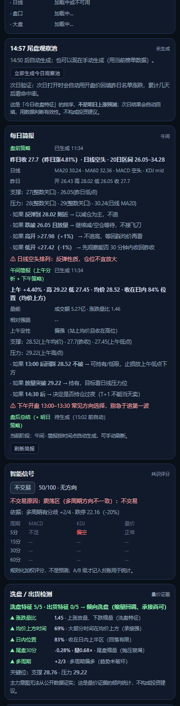

### 计划生成升级（v0.19）

「⚡ 按当前分析生成建议」补上三个短板：

| 改进 | 规则 |
|:--|:--|
| **ATR 自适应止损** | `止损 = min(支撑×0.99, 入场−1.5×ATR(15分))`，再夹在 **0.8%–6%** 区间；界面显示「止损方式：ATR(15分)×1.5」 |
| **日线关键位并入减仓档** | 减仓档 = 日内最近 2 档（前高/整数关/枢轴…）+ **日线 MA20/MA60、20/60 日高点**中最近的一档；`0.25%` 内去重 |
| **仓位上限 = min(满仓, 风险预算反推)** | `满仓 = 本金÷现价`（整手）；`预算允许 = 亏损预算 ÷ 单手止损风险`（整手）；取较小值 |
| **本金改为持仓时填写** | 持仓卡新增「本金/可用资金」输入（按股票分别保存）；不填才回退市场默认值 |

> 每手股数（A 股 100 股）是交易所规则，不是假设；之前错在**本金被硬编码为 2 万**，现在以你填的为准。

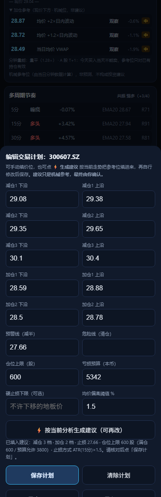

### 台账分股标识（v0.18）

之前台账是全设备累积的，但每条记录**没显示是哪只股票**，切换到别的票时容易误读（比如在拓斯达页面上看到 06166 的记录）。现在：

- 记录写入时保存**股票名**（旧记录没有名字，会显示代码）
- 每行显示：`时间 + 股票名 代码 + 方向/等级 + 进出场 + 结果`
- 多股票时新增**分股统计**：`名称 代码：N 笔 · 胜 X · 累计 Y%`
- 汇总行仍是全部股票合计，但明细一目了然

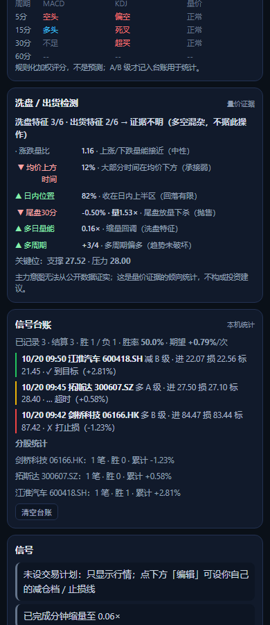

### 筛选改为「涨跌幅上限」（v0.17）

不再用"目标 ±5%/±8%"的区间中心，而是**上限**语义：

| 板 | 规则 |
|:--|:--|
| 沪深主板 | **\|涨跌幅\| < 5%** 才进池（≥5% 或涨停/跌停一律剔除） |
| 创业板 / 科创板 | **\|涨跌幅\| < 8%** 才进池 |
| ST | \|涨跌幅\| < 2.5% |

- **涨跌都可**：跌 4.5% 的票也会入选并标注「回调型」
- **打分**：收盘位置（0–5）+ 上限内波动（0–4）+ 量比（0–3）+ 换手（0–2）+ 主力净流入（0–4）
- **板块配额**：主板与双创各 5 席（不足互补），避免清一色双创
- 超出上限的会被标注「接近上限 X%」或直接剔除

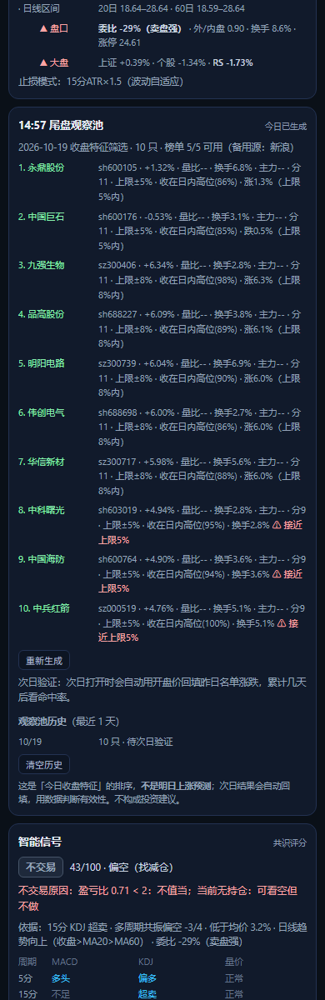

### 榜单限流的兜底（v0.16）

东财榜单接口会限流（多域名全部断连时），处理方式：

| 机制 | 说明 |
|:--|:--|
| 多域名 | `push2` / `push2delay` / `82.push2` 依次尝试，记住可用域名 |
| **新浪备用源** | 东财单榜失败时自动切新浪 `Market_Center.getHQNodeData`（带 `callback` 参数才会返回 CORS `*`） |
| 多页覆盖 | 涨幅/跌幅榜各抓 **3 页 ×100 条**，确保能覆盖主板 ±5% 的票（前 100 名几乎全是双创） |
| 自动重试 | 全部失败时 90 秒后自动重试（最多 2 次），卡片显示「榜单 N/5 可用」 |
| 数据源标注 | 用新浪时卡片显示「（备用源：新浪）」；新浪无量比/主力字段，评分只依赖目标区间/换手/收盘位置 |

**排序**：分数 → **距目标更近**（dev）→ 主力资金 → 保证同分时 ±5.0% 优先于 ±5.8%。

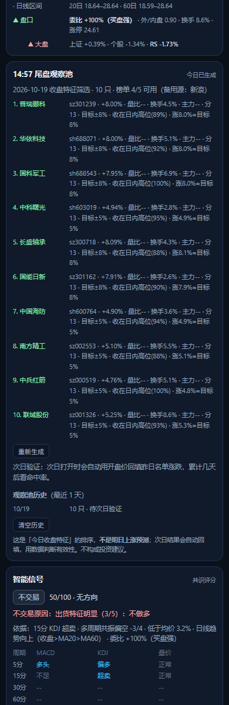

### 观察池筛选规则调整（v0.15）

按使用者偏好调整：

| 规则 | 说明 |
|:--|:--|
| **排除涨停 / 跌停** | 触板（≥限幅×98%）直接剔除，不再进入候选 |
| **目标涨跌幅** | 主板（±10%）目标 **±5%**；创业板/科创板（±20%）目标 **±8%**；ST（±5%）目标 **±2.5%** |
| **涨跌对称** | 目标达标区间内，**涨 5% 或跌 5% 同等计分**（跌幅入选会标注「回调型」） |
| 新增跌幅榜 | 榜单来源增加「跌幅榜」（按涨幅升序），否则 -5% 的票进不了池 |
| 打分 | 目标偏离 ≤1.2%(双创 1.5%) 得 6 分，≤2.4% 得 3 分，≤3.6% 得 1 分，更远标注「偏离过大」 |
| 韧性 | 榜单接口支持 **3 个域名兜底**（push2 / push2delay / 82.push2）+ 重试；全挂时显示「榜单接口暂不可用」 |

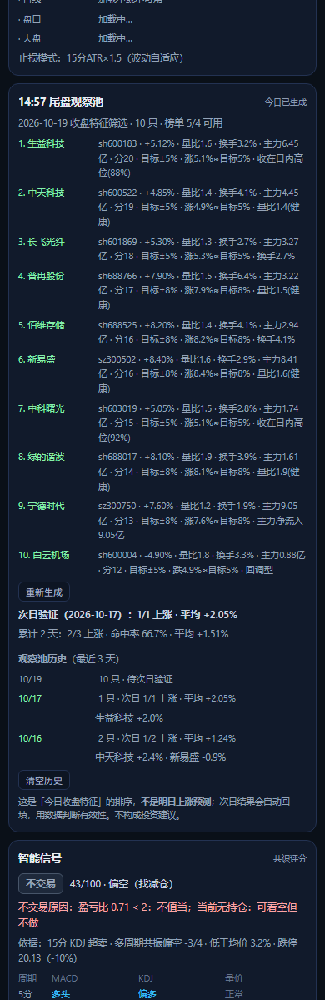

### 观察池历史列表（v0.14）

卡片底部新增历史列表（最近 10 天）：

```
次日验证（2026-10-17）：2/2 上涨 · 平均 +2.05%
累计 2 天：3/4 上涨 · 命中率 75.0% · 平均 +1.65%
观察池历史（最近 3 天）
10/19   10 只 · 待次日验证
10/17   2 只 · 次日 2/2 上涨 · 平均 +2.05%
        中科曙光 +3.3% · 中天科技 +0.8%
10/16   2 只 · 次日 1/2 上涨 · 平均 +1.24%
        亨通光电 +3.1% · 生益科技 -0.6%
[清空历史]
```

- 每天一行，已验证的显示「次日 N/M 上涨 · 平均 x%」，未验证的显示「待次日验证」
- 已验证的展开显示前 6 只的次日涨跌
- 底部有「清空历史」按钮（确认后生效）
- 数据都在本机 localStorage（最多保留 10 天）

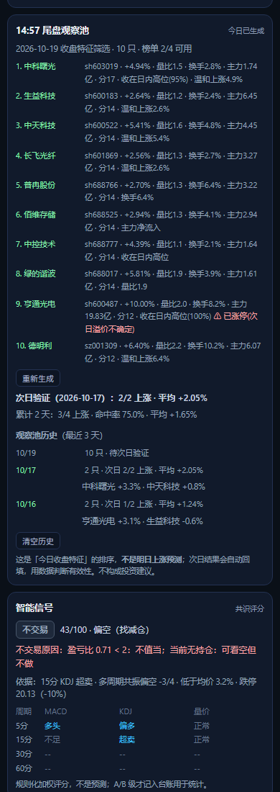

### 14:57 尾盘观察池（v0.13）

**明确：这不是"明日金股"，不是上涨预测。** 它是"今天收盘时呈现出这些特征"的排序 + **次日自动回填验证**。

| 项目 | 说明 |
|:--|:--|
| 触发 | A 股 14:50–15:05 自动生成一次；也可随时点「立即生成」 |
| 数据 | 东财榜单 4 张（涨幅榜 / 量比榜 / 换手榜 / 主力净流入榜），顺序请求 + 重试；显示「榜单 N/4 可用」 |
| 打分 | 收盘位置(0–5) + 涨幅区间(0–3) + 量比(0–3) + 换手(0–2) + 主力净流入(0–4)，满分 30 |
| 输出 | 前 10 只：名称/代码/涨跌/量比/换手/主力净额/得分/入选理由/**
风险标注**（涨停、换手过热、量比过热、主力净流出、追高风险） |
| 次日验证 | 次日打开页面时自动拉这 10 只的批量快照，统计「N/10 上涨 · 平均涨跌」，累计多日后给出**命中率** |

**为什么这样设计**：任何"明天涨"的标签都无法被证明；只有"今日特征 → 次日结果"的对照统计，跑几周后才能知道这些特征有没有用。命中率 ≤ 50% 就说明该丢弃。

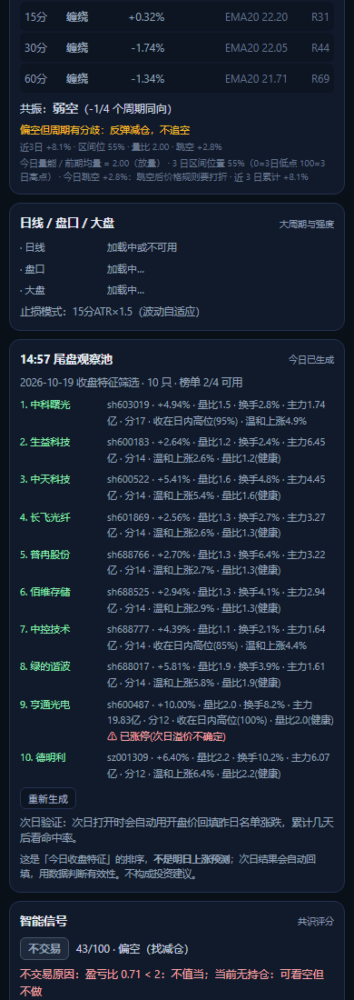

### 大周期 / 盘口 / ATR / 大盘（v0.12）

四个新数据源，全部实测可用（CORS `*`）：

| 数据 | 来源 | 新增能力 |
|:--|:--|:--|
| **日 K 线（250 根）** | 腾讯 `fqkline` | 日线 MA5/10/20/60、日线 MACD/KDJ、20/60 日高低、缺口、**日线趋势过滤** |
| **A股五档盘口** | `qt.gtimg.cn`（88 字段） | **委比/委差、外盘/内盘（主动买卖）、换手率、精确涨停/跌停价** |
| **大盘分时** | 腾讯 minute（上证/深成/恒指） | **相对强弱 RS**：个股涨幅 − 大盘涨幅 |
| **ATR(14)** | 本地由 15 分钟 K 线计算 | **自适应止损与仓位**：止损 = 入场 − 1.5×ATR，仓位 = 预算 ÷ 止损距离 |

**接入评分的方式**：
- 日线趋势向上 +2 / 向下 +2（做多降权）；日线 MACD 金叉/死叉 ±1；顶/底背离 ±1；KDJ 超买/超卖 ±0.5
- 日线**空头排列**时直接否决做多（一票否决「日线趋势向下：不逆势做多」）
- 委比 ≥ +20% 加买盘权重、≤ −20% 加卖盘权重；外/内盘 ≥1.2 或 ≤0.8 ±0.5
- 个股强于大盘 ≥ +1% 加分，弱于 ≥1% 扣分
- 止损距离被限制在 **0.8%–6%**（波动太小或太大时夹紧），界面上显示"止损模式：15分ATR×1.5"

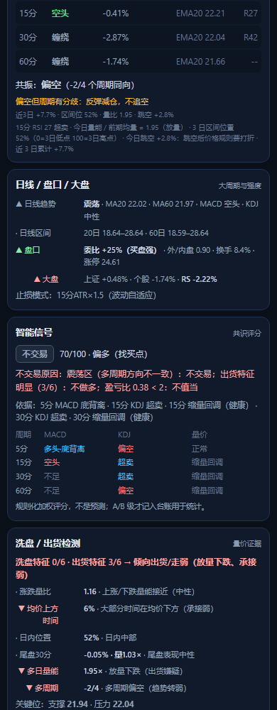

### 洗盘 / 出货证据检测（v0.11）

新增一张卡：用 **6 个量价维度**统计"洗盘特征"与"出货特征"各占几条，给出倾向结论。

| 维度 | 洗盘倾向 | 出货倾向 |
|:--|:--|:--|
| 涨跌量比（上涨分钟量 ÷ 下跌分钟量） | ≥1.3（上涨有量） | ≤0.75（下跌有量） |
| 均价上方时间占比 | ≥60%（承接强） | ≤30%（承接弱） |
| 日内位置（现价在日内高低之间） | ≥60%（收在上半区） | ≤25%（贴日内低） |
| 尾盘 30 分钟（涨跌 + 量能比） | 放量回拉 / 缩量横盘 | 放量下杀 |
| 多日量能（今日 vs 前几日均量） | 缩量回调 | 放量下跌 |
| 多周期方向 | 偏多 | 偏空 |

- 结论：洗盘特征 ≥ 出货特征 +2 → 倾向洗盘；反之 → 倾向出货/走弱；否则"证据不明（多空混杂，不据此操作）"
- **接入共识评分**：出货特征明显时自动加一条一票否决「出货特征明显（N/M）：不做多」
- 页面同时给出**关键位：支撑 / 压力**

> 诚实边界：**"主力意图"无法从公开数据证实**。这是量价证据的倾向统计，不是意图判定，也不构成投资建议。

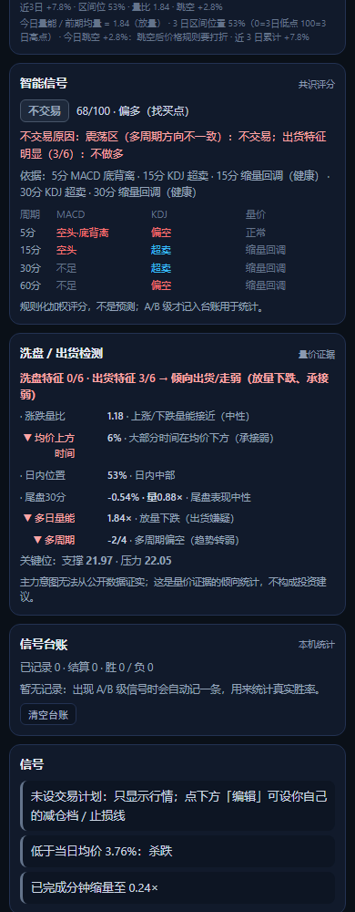

### 涨跌停显式规则（v0.10）

A 股封在涨停/跌停附近时，**当日顺势方向没有空间**，一律否决：

| 板 | 幅度 | 涨停时 | 跌停时 |
|:--|:--:|:--|:--|
| 沪深主板 | 10% | 不是"减仓"方向 → 「涨停 X（+10%）：当日无上行空间，不追」 | 不是"持有/买入"方向 → 「跌停 X（-10%）：当日无下行空间，不杀跌」 |
| 创业板 / 科创板 | 20% | 同上 | 同上 |
| 北交所 | 30% | 同上 | 同上 |
| 港股 / 美股 | 无涨跌停 | 不适用 | 不适用 |

实践含义：涨停板当天买入，**理论最大当日收益 = 0**（不能再涨），而下跌风险 4–10%，
所以任何"涨停追入"的盈亏比必然 < 2 → 系统直接拒绝，而不是靠"追高"间接拒绝。

### 数据限制（如实标注，不假装有数据）

| 周期 | MACD 需要 35 根 bar | 3 天历史下 |
|:--|:--|:--|
| 5 分钟 | 175 分钟 | ✅ 上午 12:25 后可用 |
| 15 分钟 | 约 2 天 | ✅ 有 3 日历史时可用；仅今日数据需 3 小时以上 |
| 30 分钟 | 约 4.4 天 | ⚠️ MACD 不可用（KDJ/量价/EMA 可用） |
| 60 分钟 | 约 8.75 天 | ⚠️ 同上（历史源最多 3 天） |

### 信号台账（用来验证"成功率"，而不是听我保证）

- 出现 **A/B 级**信号时自动记一条（同方向 30 分钟内去重）
- 之后按 45 分钟窗口用最新价结算：先到目标算赢、先到止损算负、超时算过期
- 统计：**胜率 / 平均盈亏 / 期望值（%/次）**，并保留最近 4 条明细
- 数据只在本机 localStorage，可一键清空

> 期望值 = 胜率×平均盈利 + (1−胜率)×平均亏损。**只有期望值为正，这套规则才值得用作参考。**
> 跑 2–4 周后看这个数字：> 0 才有意义；≤ 0 就应该调整权重或停用。

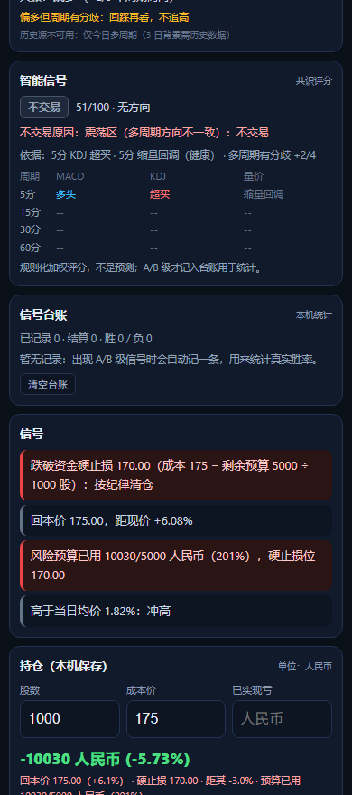

## 三点四五、加减仓数量与「建议计划」（v0.8）

### 数量不再是固定 1 手

| 方向 | 分配规则 |
|:--|:--|
| **减仓** | 按持仓比例 **25% / 35% / 剩余**，整手向下取，至少 1 手（例：1000 股 → 200 / 300 / 500） |
| **加仓** | 按「仓位上限 − 现持仓」的容量分 **50% / 剩余**，整手（例：容量 1000 → 500 / 300 / 200） |

### 计划支持加仓 + 一键建议

- 计划编辑器新增 **加仓1 / 加仓2 下沿/上沿**（保存后信号区会提示"可加 X 股"）
- 新增 **按当前分析生成建议** 按钮：把日内参考位 + 多周期支撑整理成「减仓 3 档 + 加仓 2 档 + 止损线 + 仓位上限」填进表单，**你核对/修改后再点保存**
- 建议里每档都带依据（如"日内前高 · 建议减 300 股"）

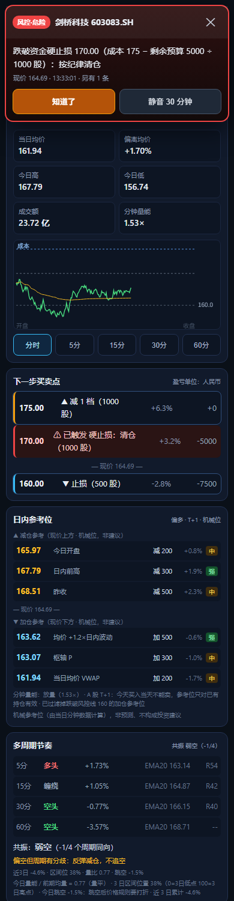

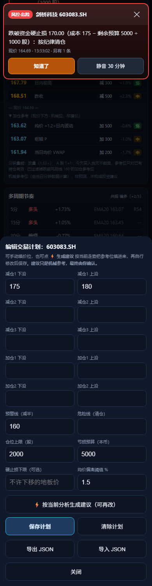

## 三点五五、怎么确认家人用的是最新版

页面**最底部**有两样东西（截图见 preview-version.png）：

| 元素 | 作用 |
|:--|:--|
| 版本 v0.6 · 2026-10-17 | 每次发版更新；家人报问题时先看这个 |
| ⟳ 强制更新 按钮 | 一键清 Service Worker 缓存 + 重载，立刻拉最新版 |

**更新机制（为什么链接方式会自动最新）**：
- GitHub Pages 的 Cache-Control: max-age=600 → 浏览器最多缓存 10 分钟
- Service Worker 对页面导航是**网络优先**：联网时永远先拉最新，只有断网才用缓存兜底
- 所以：**发链接** → 家人刷新/重开就是最新；**发文件/压缩包** → 永远是那一份旧快照

### 线路级兜底（v0.7）

同一厂商有多个等价域名，已全部接入，共 **7 个端点**：

| 厂商 | 线路 | 状态 |
|:--|:--|:--|
| 腾讯分钟线 | `web.ifzq.gtimg.cn` / `ifzq.gtimg.cn` / `proxy.finance.qq.com` | ✅ 3 条都通 |
| 东财分时 | `push2his` / `push2` / `push2delay` | ✅ 3 条都通 |
| 腾讯快照 | `qt.gtimg.cn`（GBK，只有报价） | ✅ |

单条线路失败只冷却它自己（5 分钟），自动切下一条。

> 实测（2026-10-18）：昨晚 `web.ifzq.gtimg.cn` 返回 501 时，`ifzq.gtimg.cn` 仍然可用——多线路能绕过单域名限流。

### 为什么不能用同花顺/通达信

| 源 | 原因 |
|:--|:--|
| 通达信 | 二进制 TCP 协议（7709），浏览器无法直连，只能后端 `pytdx` |
| 同花顺 | 无 CORS、接口带 token 校验、反爬严格；猜的路径全 404 |
| Yahoo | 403（需 crumb）+ 国内网络不稳 |
| 新浪 | 需 Referer，浏览器伪造不了 |
| 雪球 | 需 cookie token |

**纯前端免费源到此为止；要更多源只能用后端代理。**

### 源健康统计（v0.7）

页面最底部显示：源健康（自 2026-10-18）：腾讯 1203 · 东财 4 · 快照 0 · 失败 2 · 累计不可用 1分30秒

跑几天后看「失败」和「累计不可用」就能判断 7 端点够不够用；数据只在本机 localStorage，不上传。

## 三点六、三源兜底与限流自保（v0.5）

| 顺序 | 数据源 | 能力 | 备注 |
|:--:|:--|:--|:--|
| 1 | 腾讯分钟线 | 分时 + 报价 | 实测会被 WAF 返回 501 |
| 2 | 东财 trends2 | 分时 + 报价 | 实测会断连 |
| 3 | **腾讯快照 qt.gtimg.cn** | **只有报价**（无分时/均价/K线） | 前面两个挂了也能保命 |

**自保机制（重要）**：
- **失败源冷却 5 分钟**：挂了就不再每 15 秒去打它，避免持续激怒限流
- **指数退避**：全部失败时 60s → 120s → 240s → 300s 再试（点 ⟳ 可立即重试）
- **保留最后已知数据**：不会因为一次失败就清空面板
- **快照模式提示**：只有报价时明确显示快照模式，并说明哪些功能不可用

> 规则：**免费公开接口不是基础设施**，会限流、会改、会挂。个人小范围用没问题，但别用脚本猛打。

## 三点六、双数据源（自动切换）

| 顺序 | 数据源 | 说明 |
|:--:|:--|:--|
| 1 | 腾讯 `web.ifzq.gtimg.cn` 分钟线 | 主源；实测偶尔会被 WAF 返回 **HTTP 501** |
| 2 | **东方财富** `push2his.eastmoney.com` trends2 | 备用源，**不同厂商**，腾讯被拦时自动接管 |

行情时间旁会显示 `· 东财` 表示当前走的是备用源；两个源都不可用时才显示"读取失败"。

> 设计动机：2026-10-17 实测腾讯分钟线接口对某 IP 返回 501 WAF 页（同域其他接口仍正常），
> 说明**单源依赖会让整个面板挂掉**。现在两个厂商互为备份，单源故障不再导致不可用。


### 各市场数据可用性（实测）

| 数据 | 港股 | A股（沪深） | 北交所 | 美股 |
|:--|:--:|:--:|:--:|:--:|
| 现价/涨跌/高低 | ✅ | ✅ | ✅ | ✅ |
| 均价 VWAP | ✅ | ✅（成交量「手」×100） | ❌ `--` | ❌ `--` |
| 成交额 | ✅ | ✅（万元 ×10000） | ❌ `--` | 部分 |
| 分时 / 5分K | ✅ | ✅ | ✅ | ❌ 仅 1 点 |

> 北交所/美股的均价与成交额缺失是接口限制，页面如实显示 `--`，不会编数字。

---

## 四、提醒能力的边界（重要，别抱错期待）

| 场景 | 能否提醒 |
|:--|:--|
| 页面在前台 | ✅ 弹窗 + 声音 + 震动 + 系统通知 |
| 页面切到后台但没被杀（手机切到别的 App） | 部分机型可以，取决于系统是否冻结浏览器；**iOS 基本会暂停** |
| **App 完全关闭 / 手机锁屏很久** | ❌ **收不到** |

**为什么？** Web Push 必须有**服务器**保存推送订阅并发送消息。本版本**没有后端**（这也是它能"零成本、发个文件就能用"的原因）。
真要"关掉也能收到"，需要升级成带后端的版本（行情代理 + 推送服务 + 账号体系），工作量约 2–4 周。

其它细节：
- **声音**：浏览器要求先有一次用户点击才能播放，所以第一次请点一下「🔔」。
- **震动**：安卓 Chrome 支持；**iOS 不支持 `navigator.vibrate`**。
- **通知**：iOS 必须"添加到主屏幕"后才允许；安卓浏览器直接可授权。

---

## 五、怎么给家人朋友用（合规做法）

1. **发文件或链接**，不收钱、不代客理财；
2. **让他们自己填计划**——这是本版本最关键的设计：内置别人的档位就变成"荐股"，风险完全不同；
3. 页面已内置免责声明，不要删掉；
4. 不要在群里公开喊"买这个"——工具和投顾的区别就在这里。

> **合规提醒**：按现行监管口径，未取得证券投资咨询业务资格，向他人提供具体买卖建议（含软件、群、公众号）存在被认定为**非法证券投资咨询**的风险。"免费"不豁免。**小范围、免费、用户自设定计划**能显著降低风险，但不等于合规；正式对外（尤其收费）前请咨询专业人士。
>
> **数据合规**：行情来自腾讯公开接口，非官方授权、可能限流或变更；**商用或大规模分发应换授权行情源**（港股实时行情本身是持牌数据）。

---

## 六、上传到 GitHub（免费 HTTPS 托管 + 手机安装）

> 前提：有 GitHub 账号（没有就先去 github.com 注册，1 分钟）。

### 路线 A：网页上传（不用装任何东西，最适合只传一次）

1. 登录 github.com → 右上角 **＋ → New repository**
   - **Repository name**：`hk-radar`（英文小写，别用中文）
   - 选 **Public**（免费账号的 Pages 只支持公开仓库）
   - **不要**勾 "Add a README" / ".gitignore"（本文件夹已有）
   - 点 **Create repository**
2. 空仓库页点 **"uploading an existing file"**（或 Add file → Upload files）
3. 打开 `E:\12-1-good\hk-radar-pwa`，**全选里面的文件**（Ctrl+A，**不要拖整个文件夹本身**），拖进上传框 → **Commit changes**
   - ⚠️ 必须让 `index.html` 落在仓库**根目录**（否则访问地址要带子目录）
4. **Settings → Pages** → Build and deployment
   - Source：**Deploy from a branch**
   - Branch：**main**，目录 **/(root)** → **Save**
5. 等 **1–2 分钟**，访问：`https://<你的用户名>.github.io/hk-radar/`

### 路线 B：命令行（以后改完一条命令就能更新）

首次（会弹浏览器让你登录 GitHub，用 Git Credential Manager 授权即可，不用记 Token）：

```powershell
cd E:\12-1-good\hk-radar-pwa
git init -b main
git config user.name  "你的GitHub用户名"
git config user.email "你的邮箱（或 <用户名>@users.noreply.github.com）"
git add -A
git commit -m "feat: 盯盘雷达 PWA 首版"
git remote add origin https://github.com/<你的用户名>/hk-radar.git
git push -u origin main
```

以后每次更新：

```powershell
cd E:\12-1-good\hk-radar-pwa
git add -A; git commit -m "update"; git push
```

### 常见问题

| 现象 | 原因 / 解决 |
|:--|:--|
| 打开是 **404** | ① `index.html` 被放进了子文件夹（必须在根目录）；② Pages 还没生成完（等 1–2 分钟）；③ 分支不是 `main` |
| 手机「添加到主屏幕」后**不能全屏** | 必须用 `https://` 打开；`manifest.json` 要能访问（本仓库已配 `.nojekyll`） |
| 改了代码手机上看不到 | PWA 有缓存：关掉页面重开；若改过 `sw.js`，把里面 `CACHE` 版本号 +1 |
| 想用**私有仓库** | GitHub Pages 对私有仓库需要付费账号；本仓库不含个人数据，公开无妨 |
| 千万不要提交 | 你自己导出的计划 JSON、持仓截图（`.gitignore` 已挡 `plan-*.json` / `持仓*.png`） |

### 上传后手机上怎么装

- **iPhone（Safari）**：打开 `https://<用户名>.github.io/hk-radar/` → 分享 → **添加到主屏幕**
- **Android（Chrome）**：打开网址 → ⋮ → **安装应用**

---

## 七、开发者说明

### 结构

`index.html` 里只有两段 `<script>`：

- `<script id="core">`：**纯逻辑**（无 DOM）——代码归一化、报文解析、VWAP、规则引擎、阶梯、轮询节奏、5 分钟聚合、提醒判定。挂在 `window.RADAR_CORE`。
- `<script id="ui">`：界面 + 轮询 + 存储（`localStorage` 键 `hk-radar-pwa-v1`）。

`core` 与 DSH 插件版同一套算法，改规则只改 core 里的 `evaluateSignals` / `buildLadder`。

### 测试

```powershell
cd E:\12-1-good\hk-radar-pwa
node test/pwa.mjs        # 290 项：静态合规检查 + 假 DOM 两个场景 + 计划编辑器 + 日内参考位 + 备用源
```

测试会检查：
- 手机 meta / manifest / 免责声明是否齐全；
- **是否误把个人计划（96.7 / 92–97 / 104–110 / 128–135 / 67.45）写进文件**（合规守卫）；
- `ui` 引用的 53 个元素 id 是否都存在于 HTML（防拼写错误）；
- 全新安装与"已有计划"两条渲染路径；
- 计划编辑器 表单 → 计划对象 的完整数据链；- 日内参考位（依据/强度/T+1/风控线过滤）与备用源解析。

### 部署检查清单

- [ ] 通过 http(s) 访问（不是 `file://`）
- [ ] `manifest.json`、`sw.js`、两个图标都能 200
- [ ] 手机上「添加到主屏幕」后能全屏打开
- [ ] 点一次「🔔」确认声音与通知权限
- [ ] 填入自己的持仓与计划，确认阶梯显示的是**你自己**的价位

### 隐私

- 所有数据（持仓、计划、自选、提醒冷却）**只存在本机 localStorage**；
- 页面只向 `web.ifzq.gtimg.cn` 请求行情，**不上传任何用户数据**；
- 无账号、无 Cookie、无统计埋点。

<!-- pages rebuild trigger: 2026-10-20 11:44:37 -->
