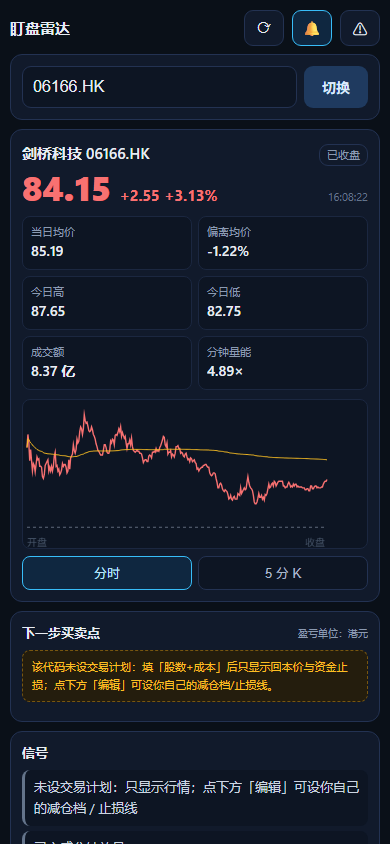
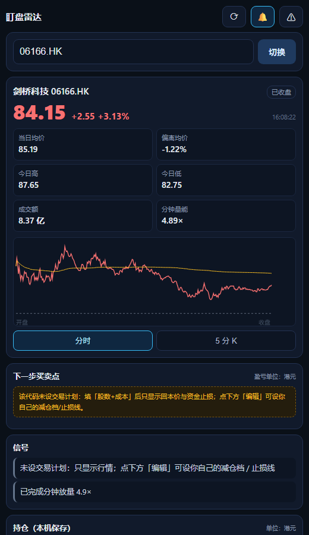
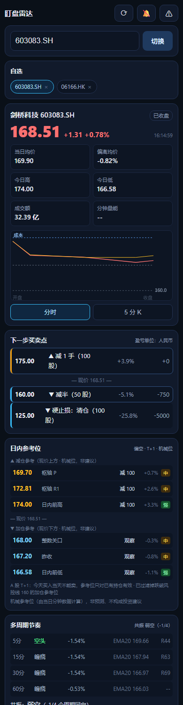
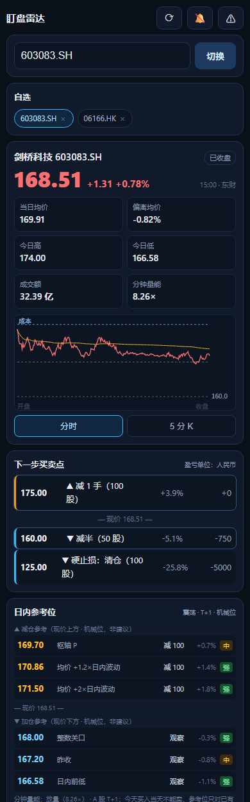

# 盯盘雷达 · 手机版（单文件 PWA）

**给家人朋友小范围用的行情 + 纪律提醒工具**。纯前端、无后端、无需注册，数据只存手机本地。

> ⚠️ 这不是投资顾问产品：**不内置任何买卖建议**。减仓档、止损线、亏损预算都要**使用者自己填**。
> 页面首屏有免责声明：仅供个人行情记录与纪律提醒，不构成投资建议，盈亏自负。

**线上地址（已部署并验证）**：https://dengfong3.github.io/hk-radar/

| 部署项 | 状态 |
|:--|:--|
| 仓库 | github.com/dengfong3/hk-radar（public） |
| Pages | main / (root)，https 自动 |
| 线上文件 SHA256 | 与本地测试版**字节一致** |
| manifest.json | 200 application/json |
| sw.js | 200 application/javascript |
| 图标 192/512 | 200 image/png |

手机扫码直接打开：






---

## 一、文件清单

```
hk-radar-pwa/
  index.html              # ★ 全部功能（HTML + CSS + JS 三段都在里面）
  manifest.json    # PWA 清单（"添加到主屏幕"后像 App 一样打开）
  sw.js                   # service worker：只缓存外壳，行情接口不缓存
  icon-192.png / icon-512.png   # 图标
  make_icons.py           # 重新生成图标的脚本（可选）
  preview-mobile.png      # 手机端渲染截图（390 宽）
  test/pwa.mjs            # 自动化验证（117 项断言）
  README.md               # 本文件
```

**只想发给人看？** 单独发 `index.html` 就能用（浏览器打开即可）。
**想装成 App？** 整个文件夹一起部署（需要 manifest + sw）。

> 布局已在 **320px（iPhone SE）与 390px** 两种宽度实测：`scrollWidth == innerWidth`，无横向滚动。

---

## 二、手机上怎么用

### 1) 先放到网上（三选一，都免费/零成本）

| 方式 | 步骤 | 适合 |
|:--|:--|:--|
| **GitHub Pages** | 新建仓库 → 上传整个文件夹 → Settings → Pages → 选 main 分支 → 得到 `https://<用户名>.github.io/<仓库>/` | 最省事、长期可用 |
| **Vercel / Netlify** | 拖文件夹到网页上即部署，得到 `https://xxx.vercel.app` | 一分钟搞定 |
| **自己的 NAS / 内网** | 放到群晖 Web Station 或任意静态服务器 | 只在家里用 |

> 注意：**别用 `file://` 直接打开**（Safari 对本地文件的存储/通知限制多）。必须通过 http(s) 访问。

### 2) 加到手机桌面（像 App 一样）

- **iPhone（Safari）**：打开网址 → 底部分享按钮 → **「添加到主屏幕」**
- **Android（Chrome）**：打开网址 → 右上角 ⋮ → **「安装应用 / 添加到主屏幕」**

加到桌面后：全屏无地址栏、独立图标、通知权限可用（iOS 需要 16.4+）。

### 3) 第一次打开

1. 顶部输入代码 → 回车（支持 `06166`、`600519`、`300750`、`AAPL`）
2. 点「🔔」开启提醒（会请求通知权限；同时点一下会解锁音频）
3. 下方「持仓」填 **股数 / 成本价 / 已实现亏**
4. 点「交易计划 → 编辑」填**你自己的**减仓档与止损线

> 没有填计划也能用：只显示行情 + 回本价 + 资金止损。

---

## 三、功能

| 区块 | 内容 |
|:--|:--|
| 行情 | 现价、涨跌、数据时间（含 `Ns前` 新鲜度，>45s 标红）、当日均价 VWAP、偏离、今日高低、成交额、分钟量能 |
| 图表 | 分时（价格线 + 均价线 + 昨收 + 你的档位线 + 成本线）/ 5 分 K（最近 36 根 + 量能） |
| 下一步买卖点 | 把**你自己填的**档位展开成阶梯：触发价 / 动作 / 距现价 / 该动作盈亏；★标出上下最近两个 |
| 信号 | 减仓区、红线、资金硬止损、满仓提示、回本价、风险预算占用、均价偏离、放量/缩量 |
| 持仓 | 股数/成本/已实现亏 → 浮盈亏、回本价、硬止损、预算占用；T 次数与成本估算 |
| 交易计划 | 编辑/清除/导出 JSON/导入 JSON（换手机可搬过去） |
| 提醒 | 页面内弹窗 + 声音 + **震动**（安卓）+ 系统通知（已授权时）；同一信号有冷却，不刷屏 |
| 自选 | 切换过的代码变成小标签，点一下来回切 |
| **日内参考位** | 用**当天**的分钟数据机械算出「减仓参考位 / 加仓参考位」+ 依据 + 强度（强/中/弱）；见下节 |
| **多周期节奏** | 5/15/30/60 分钟趋势（EMA5/EMA20 + 斜率 + RSI）+ 共振结论 + 近 3 日背景（累计涨跌/量比/区间位置/跳空） |
| 多币种 | 港股→港元、A股/北交所→人民币、美股→美元；盈亏/预算/成本自动换币种 |

---

## 三点四、多周期节奏与近 3 日背景（v0.4 新增）

短线看节奏，不能只看分时。面板新增：

| 周期 | 看什么 |
|:--|:--|
| 5 / 15 / 30 / 60 分钟 | 趋势（EMA5 vs EMA20 + 斜率）、EMA20 位置、RSI14、量能比 |
| **共振结论** | 4 个周期有几个同向 → 强多 / 偏多 / 弱多 / 震荡 / 弱空 / 偏空 / 强空 |
| **近 3 日背景** | 3 日累计涨跌、3 日高低区间位置、今日量比（vs 前几日均量）、跳空幅度 |
| **时机提示** | 例："多周期共振向上：回踩加仓、冲高减仓；别追高" / "方向分歧：等 15/30 分钟给方向" |

**数据怎么来的**：全部由**分钟数据本地聚合**（1 分钟 → 5/15/30/60 分钟），不依赖额外的 K 线接口。
- 当日实时：主源腾讯 / 备用东财（15 秒级）
- 近 3 日：东财 `trends2?ndays=3`（3 分钟拉一次，失败自动降级为"仅今日多周期"）

> ⚠️ 如果 3 日历史源不可用，面板会显示"历史源不可用：仅今日多周期（3 日背景需历史数据）"，不会编数据。


## 三点五、日内参考位（v0.3 新增，机械计算）

> 输入**任意代码**都会算，不需要你先设计划。

**它是什么**：用当天已发生的分钟数据，推出几条**可解释的参考价**，每条都告诉你依据，避免"拍脑袋"。

| 参考位来源 | 说明 |
|:--|:--|
| **日内前高 / 前低** | 当天最高/最低价 |
| **VWAP 波动带** | 当日均价 ± 1.2× / ± 2× 日内波动（5 分钟平均振幅） |
| **枢轴点** | P / R1 / R2 / S1 / S2（floor trader pivots，用现价当收盘） |
| **整数关口** | 现价上下的整数位（按价格量级自动选 0.1 / 0.5 / 1 / 2） |
| **昨收 / 今开 / 你的成本** | 常见多空分界 |

**强度（强/中/弱）**怎么来的：缩量 → 弱；距离 >6% → 弱；前高/前低 → 强；放量 + 波动带 → 强。

**还有这些过滤**：
- 加仓参考位**不会低于你计划里的风控线**（跌破止损线还加仓没有意义）
- 已达到仓位上限 → 加仓列显示「观察」
- 空仓 → 减仓列显示「观察」
- 已创日内新高/新低 → 提示"参考位失效"
- A 股标注 **T+1**、港股标注 **T+0**

**它不是什么**（重要）：
- ❌ **不是预测**，也不保证价格会到那里
- ❌ **不构成投资建议**；页面底部有固定声明
- ❌ **不触发弹窗提醒**（只有你自己设的计划档位/风控线会提醒）
- 事件、财报、跳空都会让日内参考位失效



---

### 编码坑（已修）

腾讯快照 qt.gtimg.cn 是 **GBK** 编码，而 
esponse.text() 固定按 UTF-8 解 → 中文名会变 �。
现在快照改用 rrayBuffer() + TextDecoder(gbk)，并且名字出现替换字符时直接不显示。

## 三点五五、怎么确认家人用的是最新版

页面**最底部**有两样东西（截图见 preview-version.png）：

| 元素 | 作用 |
|:--|:--|
| 版本 v0.6 · 2026-10-17 | 每次发版更新；家人报问题时先看这个 |
| ⟳ 强制更新 按钮 | 一键清 Service Worker 缓存 + 重载，立刻拉最新版 |

**更新机制（为什么链接方式会自动最新）**：
- GitHub Pages 的 Cache-Control: max-age=600 → 浏览器最多缓存 10 分钟
- Service Worker 对页面导航是**网络优先**：联网时永远先拉最新，只有断网才用缓存兜底
- 所以：**发链接** → 家人刷新/重开就是最新；**发文件/压缩包** → 永远是那一份旧快照

### 线路级兜底（v0.7）

同一厂商有多个等价域名，已全部接入，共 **7 个端点**：

| 厂商 | 线路 | 状态 |
|:--|:--|:--|
| 腾讯分钟线 | `web.ifzq.gtimg.cn` / `ifzq.gtimg.cn` / `proxy.finance.qq.com` | ✅ 3 条都通 |
| 东财分时 | `push2his` / `push2` / `push2delay` | ✅ 3 条都通 |
| 腾讯快照 | `qt.gtimg.cn`（GBK，只有报价） | ✅ |

单条线路失败只冷却它自己（5 分钟），自动切下一条。

> 实测（2026-10-18）：昨晚 `web.ifzq.gtimg.cn` 返回 501 时，`ifzq.gtimg.cn` 仍然可用——多线路能绕过单域名限流。

### 为什么不能用同花顺/通达信

| 源 | 原因 |
|:--|:--|
| 通达信 | 二进制 TCP 协议（7709），浏览器无法直连，只能后端 `pytdx` |
| 同花顺 | 无 CORS、接口带 token 校验、反爬严格；猜的路径全 404 |
| Yahoo | 403（需 crumb）+ 国内网络不稳 |
| 新浪 | 需 Referer，浏览器伪造不了 |
| 雪球 | 需 cookie token |

**纯前端免费源到此为止；要更多源只能用后端代理。**

### 源健康统计（v0.7）

页面最底部显示：源健康（自 2026-10-18）：腾讯 1203 · 东财 4 · 快照 0 · 失败 2 · 累计不可用 1分30秒

跑几天后看「失败」和「累计不可用」就能判断 7 端点够不够用；数据只在本机 localStorage，不上传。

## 三点六、三源兜底与限流自保（v0.5）

| 顺序 | 数据源 | 能力 | 备注 |
|:--:|:--|:--|:--|
| 1 | 腾讯分钟线 | 分时 + 报价 | 实测会被 WAF 返回 501 |
| 2 | 东财 trends2 | 分时 + 报价 | 实测会断连 |
| 3 | **腾讯快照 qt.gtimg.cn** | **只有报价**（无分时/均价/K线） | 前面两个挂了也能保命 |

**自保机制（重要）**：
- **失败源冷却 5 分钟**：挂了就不再每 15 秒去打它，避免持续激怒限流
- **指数退避**：全部失败时 60s → 120s → 240s → 300s 再试（点 ⟳ 可立即重试）
- **保留最后已知数据**：不会因为一次失败就清空面板
- **快照模式提示**：只有报价时明确显示快照模式，并说明哪些功能不可用

> 规则：**免费公开接口不是基础设施**，会限流、会改、会挂。个人小范围用没问题，但别用脚本猛打。

## 三点六、双数据源（自动切换）

| 顺序 | 数据源 | 说明 |
|:--:|:--|:--|
| 1 | 腾讯 `web.ifzq.gtimg.cn` 分钟线 | 主源；实测偶尔会被 WAF 返回 **HTTP 501** |
| 2 | **东方财富** `push2his.eastmoney.com` trends2 | 备用源，**不同厂商**，腾讯被拦时自动接管 |

行情时间旁会显示 `· 东财` 表示当前走的是备用源；两个源都不可用时才显示"读取失败"。

> 设计动机：2026-10-17 实测腾讯分钟线接口对某 IP 返回 501 WAF 页（同域其他接口仍正常），
> 说明**单源依赖会让整个面板挂掉**。现在两个厂商互为备份，单源故障不再导致不可用。


### 各市场数据可用性（实测）

| 数据 | 港股 | A股（沪深） | 北交所 | 美股 |
|:--|:--:|:--:|:--:|:--:|
| 现价/涨跌/高低 | ✅ | ✅ | ✅ | ✅ |
| 均价 VWAP | ✅ | ✅（成交量「手」×100） | ❌ `--` | ❌ `--` |
| 成交额 | ✅ | ✅（万元 ×10000） | ❌ `--` | 部分 |
| 分时 / 5分K | ✅ | ✅ | ✅ | ❌ 仅 1 点 |

> 北交所/美股的均价与成交额缺失是接口限制，页面如实显示 `--`，不会编数字。

---

## 四、提醒能力的边界（重要，别抱错期待）

| 场景 | 能否提醒 |
|:--|:--|
| 页面在前台 | ✅ 弹窗 + 声音 + 震动 + 系统通知 |
| 页面切到后台但没被杀（手机切到别的 App） | 部分机型可以，取决于系统是否冻结浏览器；**iOS 基本会暂停** |
| **App 完全关闭 / 手机锁屏很久** | ❌ **收不到** |

**为什么？** Web Push 必须有**服务器**保存推送订阅并发送消息。本版本**没有后端**（这也是它能"零成本、发个文件就能用"的原因）。
真要"关掉也能收到"，需要升级成带后端的版本（行情代理 + 推送服务 + 账号体系），工作量约 2–4 周。

其它细节：
- **声音**：浏览器要求先有一次用户点击才能播放，所以第一次请点一下「🔔」。
- **震动**：安卓 Chrome 支持；**iOS 不支持 `navigator.vibrate`**。
- **通知**：iOS 必须"添加到主屏幕"后才允许；安卓浏览器直接可授权。

---

## 五、怎么给家人朋友用（合规做法）

1. **发文件或链接**，不收钱、不代客理财；
2. **让他们自己填计划**——这是本版本最关键的设计：内置别人的档位就变成"荐股"，风险完全不同；
3. 页面已内置免责声明，不要删掉；
4. 不要在群里公开喊"买这个"——工具和投顾的区别就在这里。

> **合规提醒**：按现行监管口径，未取得证券投资咨询业务资格，向他人提供具体买卖建议（含软件、群、公众号）存在被认定为**非法证券投资咨询**的风险。"免费"不豁免。**小范围、免费、用户自设定计划**能显著降低风险，但不等于合规；正式对外（尤其收费）前请咨询专业人士。
>
> **数据合规**：行情来自腾讯公开接口，非官方授权、可能限流或变更；**商用或大规模分发应换授权行情源**（港股实时行情本身是持牌数据）。

---

## 六、上传到 GitHub（免费 HTTPS 托管 + 手机安装）

> 前提：有 GitHub 账号（没有就先去 github.com 注册，1 分钟）。

### 路线 A：网页上传（不用装任何东西，最适合只传一次）

1. 登录 github.com → 右上角 **＋ → New repository**
   - **Repository name**：`hk-radar`（英文小写，别用中文）
   - 选 **Public**（免费账号的 Pages 只支持公开仓库）
   - **不要**勾 "Add a README" / ".gitignore"（本文件夹已有）
   - 点 **Create repository**
2. 空仓库页点 **"uploading an existing file"**（或 Add file → Upload files）
3. 打开 `E:\12-1-good\hk-radar-pwa`，**全选里面的文件**（Ctrl+A，**不要拖整个文件夹本身**），拖进上传框 → **Commit changes**
   - ⚠️ 必须让 `index.html` 落在仓库**根目录**（否则访问地址要带子目录）
4. **Settings → Pages** → Build and deployment
   - Source：**Deploy from a branch**
   - Branch：**main**，目录 **/(root)** → **Save**
5. 等 **1–2 分钟**，访问：`https://<你的用户名>.github.io/hk-radar/`

### 路线 B：命令行（以后改完一条命令就能更新）

首次（会弹浏览器让你登录 GitHub，用 Git Credential Manager 授权即可，不用记 Token）：

```powershell
cd E:\12-1-good\hk-radar-pwa
git init -b main
git config user.name  "你的GitHub用户名"
git config user.email "你的邮箱（或 <用户名>@users.noreply.github.com）"
git add -A
git commit -m "feat: 盯盘雷达 PWA 首版"
git remote add origin https://github.com/<你的用户名>/hk-radar.git
git push -u origin main
```

以后每次更新：

```powershell
cd E:\12-1-good\hk-radar-pwa
git add -A; git commit -m "update"; git push
```

### 常见问题

| 现象 | 原因 / 解决 |
|:--|:--|
| 打开是 **404** | ① `index.html` 被放进了子文件夹（必须在根目录）；② Pages 还没生成完（等 1–2 分钟）；③ 分支不是 `main` |
| 手机「添加到主屏幕」后**不能全屏** | 必须用 `https://` 打开；`manifest.json` 要能访问（本仓库已配 `.nojekyll`） |
| 改了代码手机上看不到 | PWA 有缓存：关掉页面重开；若改过 `sw.js`，把里面 `CACHE` 版本号 +1 |
| 想用**私有仓库** | GitHub Pages 对私有仓库需要付费账号；本仓库不含个人数据，公开无妨 |
| 千万不要提交 | 你自己导出的计划 JSON、持仓截图（`.gitignore` 已挡 `plan-*.json` / `持仓*.png`） |

### 上传后手机上怎么装

- **iPhone（Safari）**：打开 `https://<用户名>.github.io/hk-radar/` → 分享 → **添加到主屏幕**
- **Android（Chrome）**：打开网址 → ⋮ → **安装应用**

---

## 七、开发者说明

### 结构

`index.html` 里只有两段 `<script>`：

- `<script id="core">`：**纯逻辑**（无 DOM）——代码归一化、报文解析、VWAP、规则引擎、阶梯、轮询节奏、5 分钟聚合、提醒判定。挂在 `window.RADAR_CORE`。
- `<script id="ui">`：界面 + 轮询 + 存储（`localStorage` 键 `hk-radar-pwa-v1`）。

`core` 与 DSH 插件版同一套算法，改规则只改 core 里的 `evaluateSignals` / `buildLadder`。

### 测试

```powershell
cd E:\12-1-good\hk-radar-pwa
node test/pwa.mjs        # 117 项：静态合规检查 + 假 DOM 两个场景 + 计划编辑器 + 日内参考位 + 备用源
```

测试会检查：
- 手机 meta / manifest / 免责声明是否齐全；
- **是否误把个人计划（96.7 / 92–97 / 104–110 / 128–135 / 67.45）写进文件**（合规守卫）；
- `ui` 引用的 53 个元素 id 是否都存在于 HTML（防拼写错误）；
- 全新安装与"已有计划"两条渲染路径；
- 计划编辑器 表单 → 计划对象 的完整数据链；- 日内参考位（依据/强度/T+1/风控线过滤）与备用源解析。

### 部署检查清单

- [ ] 通过 http(s) 访问（不是 `file://`）
- [ ] `manifest.json`、`sw.js`、两个图标都能 200
- [ ] 手机上「添加到主屏幕」后能全屏打开
- [ ] 点一次「🔔」确认声音与通知权限
- [ ] 填入自己的持仓与计划，确认阶梯显示的是**你自己**的价位

### 隐私

- 所有数据（持仓、计划、自选、提醒冷却）**只存在本机 localStorage**；
- 页面只向 `web.ifzq.gtimg.cn` 请求行情，**不上传任何用户数据**；
- 无账号、无 Cookie、无统计埋点。
